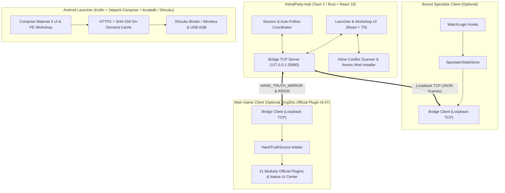

<h1 align="center">AstralParty-XingShu</h1>

<h3 align="center">Thank you for choosing AstralParty-XingShu!</h3>

<p align="center">
  <strong>Feedback &amp; Community: QQ Group <code>1080908767</code> &nbsp;|&nbsp; <a href="https://discord.gg/dxVS6ZF393">Discord</a></strong>
</p>

<p align="center">
  
</p>

<p align="center">
  Pure Launcher · Modular Plugin · Replay Analyzer · Mod Workshop · Compose Android
</p>

<p align="center">
  <a href="https://github.com/Breezecaresses/AstralParty-XingShu/releases"></a>
  
  
  
  
  
  <a href="LICENSE"></a>
</p>

<p align="center">
  <a href="https://github.com/Breezecaresses/AstralParty-XingShu/releases/tag/v0.2.0">Download Desktop v0.2.0</a> ·
  <a href="https://github.com/Breezecaresses/AstralParty-XingShu-Android">📱 Android Standalone Repo</a> ·
  <a href="https://astralparty-xingshu.lanxichaxu.cn/xingshu-hub/">Web Edition</a> ·
  <a href="docs/README.md">Docs &amp; Validation Records</a> ·
  <a href="README.md">English</a> · <a href="README_CN.md">简体中文</a>
</p>

> [!IMPORTANT]
> **Android Edition has moved to its own standalone repository**: **[Breezecaresses/AstralParty-XingShu-Android](https://github.com/Breezecaresses/AstralParty-XingShu-Android)** ([Download Android APK & Releases](https://github.com/Breezecaresses/AstralParty-XingShu-Android/releases)). This main repository focuses on **Windows Desktop Hub, in-game C# runtime, and Web Workshop**.

---

## Stable Release

[Download stable v0.2.0](https://github.com/Breezecaresses/AstralParty-XingShu/releases/tag/v0.2.0) ([release notes](docs/records/RELEASE_0.2.0.md)), targeting *Astral Party* `3.3.0` (`resource 160`).

| Target | Package / Access | Highlights |
| --- | --- | --- |
| **Windows Desktop** | `XingShu_Hub_0.2.0_x64-setup.exe` / `XingShu_Desktop_0.2.0.zip` | One-click Windows installer or streamlined portable pure-launcher Hub with the **Universal Local Mod Compatibility Engine**: `CAB-*` fingerprint alignment, native `ResourceModLoader` (`mod.json`) patching, customizable frosted-glass UI skin, Game Customize workbench, remote `core-manifest.json` hot-updates, and **16 consolidated official modules** (`r8.59`). |
| **Web Edition** | [astralparty-xingshu.lanxichaxu.cn/xingshu-hub](https://astralparty-xingshu.lanxichaxu.cn/xingshu-hub/) | Instant browser access for Modrinth-style **Mod / Card / Skin Workshop**, character emote reactions, XingShu Platform accounts, UID lookup, `.rep` / match-ID replay analysis, and offline encyclopedia. |
| **Android Launcher (Standalone Repo)** | **[AstralParty-XingShu-Android · Releases](https://github.com/Breezecaresses/AstralParty-XingShu-Android/releases)** | Dedicated repository **[AstralParty-XingShu-Android](https://github.com/Breezecaresses/AstralParty-XingShu-Android)** (`v0.2.1+` / `android-preview8.60`): Kotlin + Jetpack Compose Material 3 pure launcher, Workshop emote reactions, Custom Lobby Background & Game Customize workbench, 16 official modules + legacy cleaner, and Shizuku / Wireless ADB sync. See [ANDROID_PHONE_INSTALL.md](docs/guides/ANDROID_PHONE_INSTALL.md). |

> [!NOTE]
> The Core Framework (`XingShu Official Plugin Mod`) is completely independent from both Desktop Hub and Android APKs—future core runtime or game-baseline updates install directly via remote manifests without upgrading the launcher. See the [v0.1.10 release record](docs/records/RELEASE_0.1.10.md) and [packaging guide](docs/guides/RELEASE_PACKAGING.md).

---

## Overview

**AstralParty-XingShu (星枢)** is an open-source multi-platform launcher, mod workshop, replay workstation, and modular in-game runtime suite built for *Astral Party* (吉星派对):

1. **AstralParty-Hub (Desktop & Web)**: Built with Tauri 2 + Rust + React 19 + TypeScript. Launches vanilla clients out of the box and embeds a universal local mod compatibility engine (cross-version Catalog resolution, localized `CAB-*` fingerprint bundle matching, native RML `mod.json` patching, lossless `Texture2D -> modimg` conversion, `.rar`/encrypted archive extraction, and rogue DLL blocking) alongside single-flight locking, 4-way concurrent EdgeOne-cached downloads, local SHA-256 verification, atomic backups, live room management, `.rep` replay playback, platform accounts, and an offline encyclopedia.
2. **XingShu Official Plugin Mod (`r8.47` PC / `android-preview8.47` Android, C# / Unity)**: Independent hot-updatable in-game runtime featuring **21 independently toggleable official modules** (including **Megath Skill Damage Calculator**, **Board & Avatar-Bottom Player Combat Status HUD**, Custom Lobby Background, `xingshu_dynamic_cards/` video card loader, actual damage match statistics, teammate hand overlay, battle hints, discard guard, and FairyGUI-styled native UI center).
3. **Android Pure Launcher (`AndroidInstaller`, Kotlin / Jetpack Compose)**: Polished Material 3 companion app with symmetric `3×2` color palette, compact first-screen density, remote `CoreRuntimeSpec` hot-updates, custom XingShu bottom navigation bar, dynamic wallpaper support, Shizuku / ADB management, 21 official modules, and PE Mod Workshop.

---

## Key Capabilities in v0.1.10

- **Desktop Universal Local Mod Engine (`CAB-*` + RML Native Parsing)**: Automatically inspects UnityFS header chunks of Chinese/localized skin & motion bundles to match `CAB-*` fingerprints against local `3.3.0` containers; parses community `ResourceModLoader` (`mod.json`) archives natively (`Redirect` `TextAsset`/`Texture2D`, `.patch.bnk` Wwise `.wem` injection, `.patch.proto` patching) while safely skipping `ResourceModLoader.exe` and blocking untrusted executables.
- **21 Official Modules & Live Core `r8.47` / `android-preview8.47`**:
  - **#20 `megath-damage` (Megath Skill Damage Calculator)**: Displays a draggable theoretical maximum damage overlay whenever the local hero is Megath (`HeroId = 122`), computing hand-card bombardment total (`floor(cards / 2)` shots, `3 + ceil(cost / 3)` PVE damage per shot) and highlighting alive monsters carrying `Precision Strike` (`Buff 1221202`) `+1/shot` bonus.
  - **#21 `player-combat-hud` (Player Combat Status HUD)**: Locks board head status pills inside `com_AttrInfos` (`sortingOrder = 0`, matching monster target deduction) anchored to visual character head height with Y fine-tune, and renders draggable/adjustable `CD / Atk / Def` strips directly below left-side player avatar coin/star bars.
  - **Battle Stats Widget Settings Relocation**: Consolidated `Card_StatsWidgetSettings` into the Battle Stats tab, pointed the in-game stats widget "Settings" button directly to Battle Stats, and removed redundant panels.
- **EdgeOne CDN Acceleration & Workshop Coverage**: Backed by EdgeOne CDN + BBR + local SHA-256 payload caching; Workshop updated with `megath-damage` and `player-combat-hud` `.xspkg` entries, full `BA Music Pack`, and PE `modimg` packages.
- **Unified Native In-Game Control Center & Replay Analyzer**: Press `F1` (or tap the floating orb) for consistent PC/mobile native FairyGUI controls and 12 remappable hotkeys ([HOTKEYS.md](docs/guides/HOTKEYS.md)); analyze `.rep` or match-ID replays with interactive round charts and step-by-step board playback.

---

## Architecture Overview



---

## Security & Integrity Guarantees

- **Strict Hash & Signature Verification**: Self-updates validate RSA-signed manifests (`xingshu-update.json`); Desktop and Android runtime downloads enforce HTTPS and full SHA-256 verification against pinned channel manifests.
- **Safe Mod Archive Handling**: Desktop `.xspkg` / `.zip` installers reject path traversal, symlinks, and arbitrary executable overwrites while maintaining `.xingshu-backup` / `.xingshu-mods` snapshots for lossless recovery.
- **Authoritative Hand Truth (`HandTruthSource`)**: Mirrors verified co-op hand snapshots strictly over loopback `127.0.0.1` validated against active match heroes without placeholder fabrication.

---

## Directory Structure

```text
AstralParty-XingShu/
├── AstralParty-Hub/                      # Tauri 2 + React 19 Desktop Launcher & Web Workshop
│   ├── src/                              # Launcher, Workshop, Encyclopedia, Replay, Room & Settings UI
│   ├── src-tauri/                        # Rust backend (IPC bridge, inline inspector, SHA-256 installer)
│   └── public/                           # Static brand, encyclopedia media & animated emotes
├── XingShu-Dev/                          # In-game C# Unity modular runtime
│   ├── src/XingShu.Runtime/              # 21 official modules, Native UI Center, HandTruth & Room control
│   └── tools/                            # MSBuild scripts, C# conformance & lifecycle test runners
├── AndroidInstaller/                     # Kotlin + Jetpack Compose Android Pure Launcher
│   ├── app/                              # Compose UI, Shizuku integration, HTTPS SHA-256 cache & tests
│   └── localadb/                         # Wireless/USB ADB protocol module
├── tools/                                # Release packagers, APK builder, signer & Python unit tests
├── docs/                                 # User guides and validation/release records
└── LICENSE                               # AstralParty-XingShu License & Fair Use Terms
```

---

## Build & Setup

> [!NOTE]
> This repository **does not contain** proprietary game binaries, DLLs, signing keystores, or account credentials.

### 1. AstralParty-Hub (Desktop & Web)

- Prerequisites: Node.js 20+, Rust & Cargo (stable), MSVC C++ Build Tools, Microsoft Edge WebView2.

```bash
cd AstralParty-Hub
npm ci

# Build Web Edition
npm run build:web

# Run TypeScript & Rust verification tests
npx tsc --noEmit
npm run test:all
cargo test --manifest-path src-tauri/Cargo.toml --locked --offline --lib

# Build Tauri Desktop Installer / Binary
npx tauri build -- --locked --offline
```

### 2. XingShu Runtime (C# Game Plugin)

- Prerequisites: Visual Studio MSBuild (C# 11 / `.NET Framework 4.0` target), Python 3.x, Mono.Cecil in `XingShu-Dev/tools/lib`.
- Extract `AstralParty.Runtime.dll` from your legally owned game client into `XingShu-Dev/references/` (or pass `AstralPartyRuntimePath`).

```powershell
.\XingShu-Dev\tools\build.ps1 -Configuration Release
```

### 3. Android Edition (Moved to Standalone Repository)

- Active Android development and mobile releases now live in **[Breezecaresses/AstralParty-XingShu-Android](https://github.com/Breezecaresses/AstralParty-XingShu-Android)**.
- Prerequisites: JDK 17, Android SDK (`compileSdk 35`), Gradle 8.9.

---

## Detailed Documentation

- [docs/README.md](docs/README.md) — Documentation Index & Release / Validation Records
- [RELEASE_0.1.10.md](docs/records/RELEASE_0.1.10.md) — v0.1.10 Release Notes (RML/CAB Universal Mod Compat & 21 Modules)
- [RELEASE_0.1.9.md](docs/records/RELEASE_0.1.9.md) — v0.1.9 Release Notes (Universal Local Mod Compat & Mobile UI Polish)
- [RELEASE_0.1.8.md](docs/records/RELEASE_0.1.8.md) — v0.1.8 Release Notes & Independent Core Architecture
- [RELEASE_0.1.7.md](docs/records/RELEASE_0.1.7.md) — v0.1.7 Release Notes & Architecture Changes
- [ANDROID_PHONE_INSTALL.md](docs/guides/ANDROID_PHONE_INSTALL.md) — Android Installation & Recovery Guide
- [HOTKEYS.md](docs/guides/HOTKEYS.md) — In-Game Shortcuts Configuration
- [AUTO_FOLLOW_PROTOCOL.md](docs/guides/AUTO_FOLLOW_PROTOCOL.md) — Auto-Follow Loopback TCP Protocol
- [AUTO_FOLLOW_STATE_MACHINE.md](docs/guides/AUTO_FOLLOW_STATE_MACHINE.md) — 11-State Finite State Machine Specification
- [HAND_TRUTH_SOURCE_ARCHITECTURE.md](docs/guides/HAND_TRUTH_SOURCE_ARCHITECTURE.md) — Hand Truth Single Source of Truth Architecture
- [OVERLAY_LIFECYCLE_RECONCILIATION.md](docs/guides/OVERLAY_LIFECYCLE_RECONCILIATION.md) — Floating Overlay Adaptive Lifecycle Reconciliation
- [local-managed-watcher.md](AstralParty-Hub/docs/local-managed-watcher.md) — Local Managed Watcher Setup
- [extension_channels.md](AstralParty-Hub/docs/specs/extension_channels.md) — Extension Channels & Manifest Boundaries

---

## Disclaimer & License

1. Intended strictly for technical research, local testing, mod management, and community tooling.
2. No proprietary game binaries or commercial game assets are relicensed; official game assets remain copyright of their respective owners.
3. Please abide by official game Terms of Service. Users assume full responsibility for their own usage.
4. Source code in this repository is governed by the [AstralParty-XingShu License & Fair Use Terms](LICENSE) (source-available, personal/non-commercial use, attribution & share-alike for forks).
