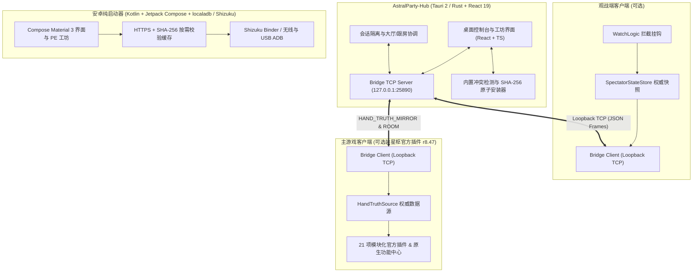

<h1 align="center">AstralParty-XingShu</h1>

<h3 align="center">感谢您选择 AstralParty-XingShu（星枢）！</h3>

<p align="center">
  <strong>反馈问题与建议：QQ 群 <code>1080908767</code> &nbsp;|&nbsp; <a href="https://discord.gg/dxVS6ZF393">Discord</a></strong>
</p>

<p align="center">
  
</p>

<p align="center">
  纯启动器架构 · 模块化官方插件 · 回放复盘 · 模组工坊 · 全新 Compose 安卓端
</p>

<p align="center">
  <a href="https://github.com/Breezecaresses/AstralParty-XingShu/releases"></a>
  
  
  
  
  
  <a href="LICENSE"></a>
</p>

<p align="center">
  <a href="https://github.com/Breezecaresses/AstralParty-XingShu/releases/tag/v0.1.10">下载 v0.1.10</a> ·
  <a href="https://astralparty-xingshu.lanxichaxu.cn/xingshu-hub/">在线网页版</a> ·
  <a href="docs/README.md">文档与验证记录</a> ·
  <a href="README.md">English</a> · <a href="README_CN.md">简体中文</a>
</p>

---

## 正式版本

[下载星枢 v0.1.10](https://github.com/Breezecaresses/AstralParty-XingShu/releases/tag/v0.1.10)（详见[发布记录](docs/records/RELEASE_0.1.10.md)），电脑端与安卓手机端同步适配《吉星派对》`3.3.0`（资源版本 `160`）。

| 平台 | 获取方式 | 说明 |
| --- | --- | --- |
| **Windows 桌面端** | `XingShu_Hub_0.1.10_x64-setup.exe` / `XingShu_Desktop_0.1.10.zip` | **极简纯启动器 + 万能本地 Mod 自动适配引擎**：提供一键安装包与便携包（仅含 `Hub/xingshu-hub.exe` 与说明文档）。支持旧版 Mod Catalog 跨版本反查、中文改名包 `CAB-*` 指纹匹配与 RML（`mod.json`）原生解析、`.rar`/加密包解压、`core-manifest.json` 独立热更新与 **21 项官方模块**（`r8.47`）。 |
| **在线网页版** | [astralparty-xingshu.lanxichaxu.cn/xingshu-hub](https://astralparty-xingshu.lanxichaxu.cn/xingshu-hub/) | 免安装打开即用：Modrinth 风格社区**模组 / 卡牌 / 皮肤工坊**浏览下载与作者投稿、星枢平台账号体系、UID 战绩查询、`.rep` / 对局编号回放深度分析与离线全量图鉴。 |
| **安卓手机端** | `XingShu_Android_0.1.10.apk` / `XingShu_Android_0.1.10.zip` | 全新排版优化的 Kotlin + Jetpack Compose Material 3 **轻量纯启动器**：支持直装 APK 或极简 ZIP（仅含 `星枢启动器.apk` 与说明文件）。新增对称 `3×2` 色板、紧凑首屏与横向筛选栏，支持独立 `android-core-manifest.json`（`android-preview8.47`）与 **21 项官方模块**一键安装及 Shizuku/ADB 同步，内置工坊实时更新。详见[手机安装说明](docs/guides/ANDROID_PHONE_INSTALL.md)。 |

> [!NOTE]
> 自 `0.1.8` 起，核心框架（**星枢官方插件 Mod**）已彻底解耦并独立托管：未来发布新版核心插件或适配游戏新版本时，老版本电脑 Hub 与手机 APK 均可在「模组」页直接在线热更核心插件，无需重装启动器。详见[v0.1.10 发布记录](docs/records/RELEASE_0.1.10.md)与[发布打包说明](docs/guides/RELEASE_PACKAGING.md)。

---

## 项目简介

**AstralParty-XingShu（星枢）** 是面向《Astral Party》（吉星派对）的多端纯启动器、模组工坊、回放分析平台与模块化游戏增强套件：

1. **AstralParty-Hub（桌面端 & 网页版）**：基于 Tauri 2 + Rust + React 19 + TypeScript 构建。桌面端默认以纯净启动器运行，内置万能本地 Mod 自动适配引擎（跨版本 Catalog 反查、中文改名 `CAB-*` 指纹匹配、RML `mod.json` 原生补丁解析、贴图无损转 `modimg`、`.rar`/加密包解压与危险 DLL 拦截）、远端核心清单独立热更新、Rust 单飞锁防连点与 4 路并发 SHA-256 缓存下载、跨版本备份还原与 `.rep` 逐帧回放复盘。
2. **星枢官方插件 Mod（`r8.47` 电脑端 / `android-preview8.47` 手机端，C# / Unity）**：独立可热更新游戏内插件核心，提供 **21 项**可单独开关或一键安装的官方功能模块（含**梅加斯理论伤害计算面板**、**棋盘角色头顶与头像下方状态 HUD**、自定义大厅背景、动态立绘加载器 `xingshu_dynamic_cards/`、对局实际造成伤害统计、队友手牌监视、防御预测、战斗点数提示、弃牌防误触与原生游戏内功能中心）。
3. **全新安卓纯启动器（`AndroidInstaller`，Kotlin / Jetpack Compose）**：采用 Material 3 与原创顶部指示线底部导航栏，优化了各页首屏密度与对称色板布局，支持远端 `CoreRuntimeSpec` 独立核心热更、动态配色/壁纸、Shizuku/无线 ADB 双通道、21 项官方模块管理、PE 模组工坊与 Windows 卡牌方案 ZIP 导入。

---

## v0.1.10 核心功能亮点

- **桌面端「万能本地 Mod 自动适配引擎」再升级（`CAB-*` + RML 原生适配）**：当多对象模型/动作包的 `.bundle` 被中文改名时，自动读取 UnityFS 头部块提取 `CAB-*` 指纹对齐本地 `3.3.0` 原版容器；拖入含合法 `mod.json` 的社区 `ResourceModLoader` 补丁包时安全跳过附带的 `ResourceModLoader.exe`（其余可执行文件仍严格拦截），原生应用 `Redirect`（`TextAsset`/`Texture2D`）、`.patch.bnk` 音库与 `.patch.proto` 配置补丁；同时保留跨版本 `catalog_3.3.0.json` 反查与 `modimg` 一键导出能力。
- **双端 21 项官方功能模块 & 核心热更新 `r8.47` / `android-preview8.47`**：
  - **#20 梅加斯伤害计算（`megath-damage`）**：选择梅加斯（`HeroId = 122`）开局时自动显示独立可拖拽面板，严格按公式（`⌊手牌数/2⌋` 炮数、`3 + ⌈总费用/3⌉` PVE 单炮伤害）统计手牌轰炸总伤，并在场上存活怪物存在「精准打击」(`Buff 1221202`) 时额外标注每炮 +1 伤参考。
  - **#21 角色状态显示（`player-combat-hud`）**：棋盘角色头顶状态与怪物逻辑推演（`com_AttrInfos`）同层锁死不可拖动并按视觉头顶比例贴合高度（支持 Y 偏移微调），左侧玩家头像金币星级栏下方同步显示可自由拖动/微调的 `CD / 基础攻防` 状态栏。
  - **对局数据挂件设置迁移**：将原位于「高级设置」的 `对局数据挂件设置` 整合至「对局数据」页并让局内悬浮窗「设置」按钮直达，同时清理重复面板。
- **EdgeOne CDN 加速 + 4 路并发缓存与工坊扩展**：全站接入 EdgeOne CDN 与 `tcp_bbr`，本地 `.xingshu-mods/payload-cache/` 全量 SHA-256 校验；工坊同步上架《梅加斯伤害计算》《角色状态显示》`.xspkg`、新版《BA 音乐替换》与更多 `3.3.0` / `modimg` 社区包。
- **游戏内原生功能中心 & 回放复盘**：局内按 `F1` 或点击悬浮球呼出统一 UI（支持 12 项快捷键自定义，见[快捷键说明](docs/guides/HOTKEYS.md)）；导入 `.rep` 或对局编号即可进行逐轮伤害/星币曲线分析与棋盘步进复盘。

---

## 架构概览



---

## 安全与完整性保障

- **签名更新与哈希绑定**：软件自更新严格验证 RSA 签名清单（`xingshu-update.json`）；桌面端组件与安卓按需运行库均强制 HTTPS 下载与全量 SHA-256 指纹核验。
- **安全模组安装边界**：`.xspkg` / `.zip` 扩展包安装器严格拦截路径穿越、符号链接及非法可执行文件覆盖，并在替换前自动保留 `.xingshu-backup` / `.xingshu-mods` 基线备份。
- **权威手牌真值 (`HandTruthSource`)**：合作局手牌快照仅通过本机 `127.0.0.1` 回环传递，并严格校验对局英雄名单，杜绝伪造占位牌面。

---

## 目录结构

```text
AstralParty-XingShu/
├── AstralParty-Hub/                      # Tauri 2 + React 19 桌面启动器与在线网页工坊
│   ├── src/                              # 前端源码（启动台、开房、工坊、图鉴、回放分析、账号）
│   ├── src-tauri/                        # Rust 后端（TCP 通信桥、内置冲突检测与原子安装）
│   └── public/                           # 品牌图标、离线图鉴与动态表情资源
├── XingShu-Dev/                          # 游戏内 C# Unity 模块化运行时
│   ├── src/XingShu.Runtime/              # 21 项官方模块、原生功能中心、手牌真值与房间控制
│   └── tools/                            # 编译脚本、一致性校验与生命周期测试
├── AndroidInstaller/                     # Kotlin + Jetpack Compose 安卓纯启动器源码
│   ├── app/                              # Compose UI、Shizuku 接入、HTTPS 按需缓存与单元测试
│   └── localadb/                         # 无线/USB ADB 协议实现模块
├── tools/                                # 发布包封装、APK 构建签名与 Python 自动化测试
├── docs/                                 # 使用指南、技术规范与版本发布记录
└── LICENSE                               # AstralParty-XingShu 许可与合理使用条款
```

---

## 本地构建

> [!NOTE]
> 本仓库遵循合规开源原则，**不包含**任何游戏专有 DLL、原版商业资源包、签名私钥或敏感凭据。

### 1. AstralParty-Hub（桌面端与网页版）

- 环境要求：Node.js 20+、Rust & Cargo（最新 stable）、Visual Studio C++ 生成工具、Microsoft Edge WebView2。

```bash
cd AstralParty-Hub
npm ci

# 构建在线网页版静态产物
npm run build:web

# 运行前后端校验与单元测试
npx tsc --noEmit
npm run test:all
cargo test --manifest-path src-tauri/Cargo.toml --locked --offline --lib

# 构建 Tauri 桌面端程序与安装包
npx tauri build -- --locked --offline
```

### 2. XingShu Runtime（C# 游戏插件）

- 环境要求：支持 C# 11 的 Visual Studio MSBuild（目标 `.NET Framework 4.0`）、Python 3.x、`XingShu-Dev/tools/lib` 下的 Mono.Cecil。
- 从合法拥有的客户端提取 `AstralParty.Runtime.dll` 放入 `XingShu-Dev/references/`（或指定 `AstralPartyRuntimePath`）。

```powershell
.\XingShu-Dev\tools\build.ps1 -Configuration Release
```

### 3. Android 纯启动器（Kotlin / Jetpack Compose）

- 环境要求：JDK 17、Android SDK（`compileSdk 35`）、Gradle 8.9。

```powershell
python tools/build_android_installer.py --help
```

---

## 详细文档与验证记录

- [项目文档与验证记录](docs/README.md) — 文档总索引与历史发布验证记录
- [RELEASE_0.1.10.md](docs/records/RELEASE_0.1.10.md) — v0.1.10 正式版更新（RML/CAB 万能 Mod 适配与 21 项官方功能模块）
- [RELEASE_0.1.9.md](docs/records/RELEASE_0.1.9.md) — v0.1.9 正式版更新（万能本地 Mod 适配与移动端优化）
- [RELEASE_0.1.8.md](docs/records/RELEASE_0.1.8.md) — v0.1.8 正式版更新与核心框架独立热更新记录
- [RELEASE_0.1.7.md](docs/records/RELEASE_0.1.7.md) — v0.1.7 正式版更新与架构重构记录
- [ANDROID_PHONE_INSTALL.md](docs/guides/ANDROID_PHONE_INSTALL.md) — 安卓手机安装与还原指南
- [HOTKEYS.md](docs/guides/HOTKEYS.md) — 游戏内快捷键自定义说明
- [AUTO_FOLLOW_PROTOCOL.md](docs/guides/AUTO_FOLLOW_PROTOCOL.md) — 自动跟房本地 TCP 通信协议规范
- [AUTO_FOLLOW_STATE_MACHINE.md](docs/guides/AUTO_FOLLOW_STATE_MACHINE.md) — 自动跟房 11 状态机设计说明
- [HAND_TRUTH_SOURCE_ARCHITECTURE.md](docs/guides/HAND_TRUTH_SOURCE_ARCHITECTURE.md) — 手牌真值单源架构与防伪造设计
- [OVERLAY_LIFECYCLE_RECONCILIATION.md](docs/guides/OVERLAY_LIFECYCLE_RECONCILIATION.md) — 浮动挂件生命周期自适应调和规范
- [local-managed-watcher.md](AstralParty-Hub/docs/local-managed-watcher.md) — 本机托管观战说明
- [extension_channels.md](AstralParty-Hub/docs/specs/extension_channels.md) — 扩展包渠道声明与目录映射边界

---

## 免责声明与授权条款

1. 本项目仅供技术研究、本地测试、模组管理与社区交流学习使用。
2. 原游戏美术、文本、配置与音画资产版权均归原权利人所有，不随本项目代码许可证重新授权。
3. 请合理合规使用辅助功能并遵守游戏官方服务条款；开发者不对不当使用引发的账号风险承担责任。
4. 本仓库代码采用《[AstralParty-XingShu 许可与合理使用条款](LICENSE)》（源码公开、限个人非商用，衍生分支须署名并保持同条款开源）。
